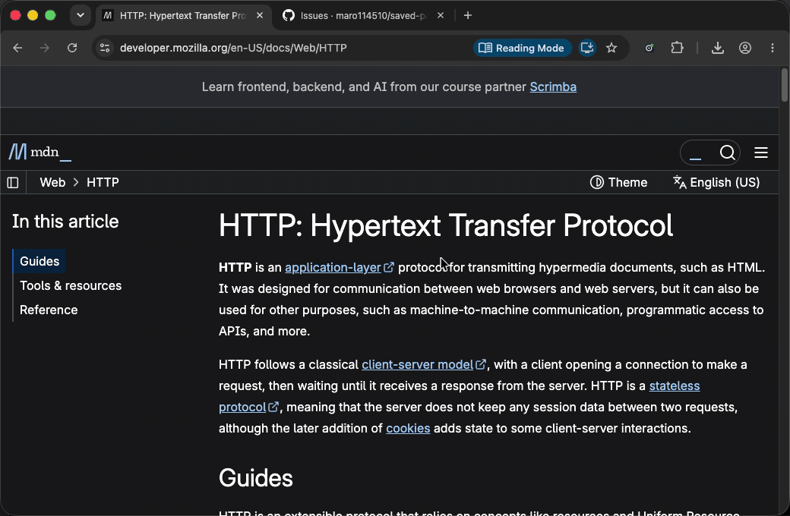
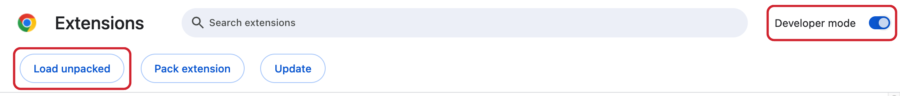
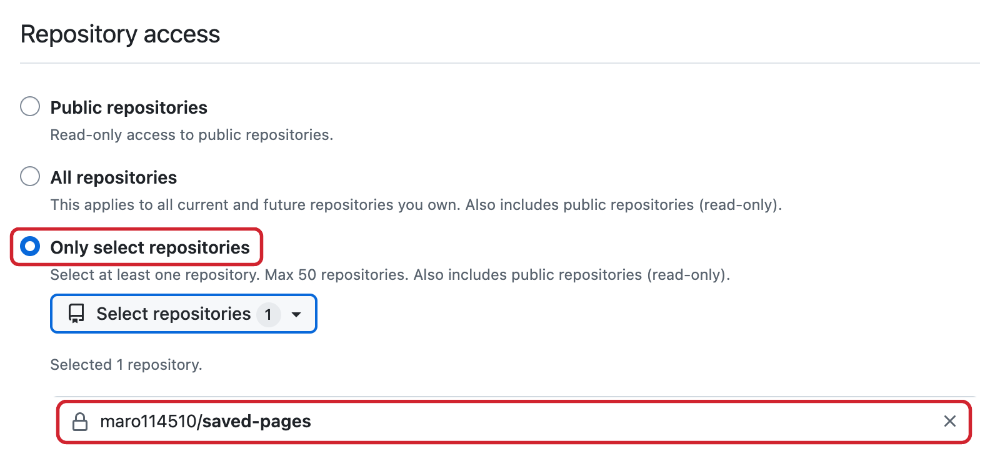
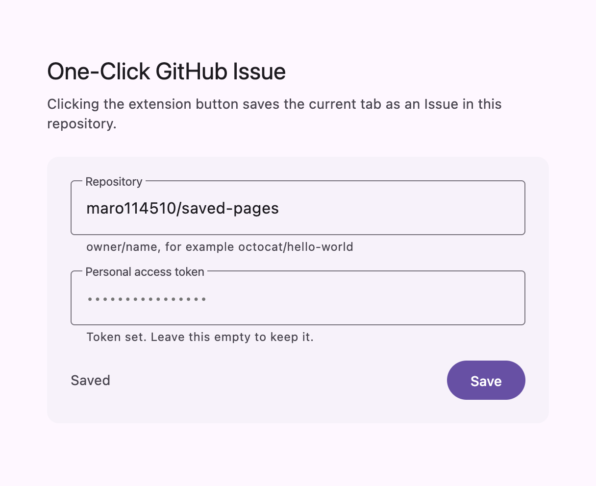

# One-Click GitHub Issue

[English](README.md) | 日本語

見ているページを GitHub の Issue として保存します。クリック 1 回、入力欄なし。



**[⬇ 最新版をダウンロード](https://github.com/maro114510/one-click-github-issue/releases/latest/download/one-click-github-issue.zip)**
· Chrome · セットアップは約 5 分

| Issue の項目 | 内容                                     |
| ------------ | ---------------------------------------- |
| タイトル     | ページのタイトル。タイトルがなければ URL |
| 本文         | ページの URL                             |

[One-Click TickTick](https://github.com/chrschorn/one-click-ticktick) に着想を得ました。アイデアとわかりやすい設計に感謝します。

> [!NOTE]
> Chrome のラベルは日本語表示の Chrome に合わせています。GitHub の画面は英語のみなので、GitHub のラベルは画面どおり英語で書いています。

## 始める前に

- GitHub アカウント
- パスワードマネージャー、またはトークンを安全に保管してコピーできる場所

> [!IMPORTANT]
> トークンをディスクに残さないため、Chrome の再起動時と拡張機能の更新時に、拡張機能はトークンを忘れます。貼り直しは数秒で済みます。

> [!NOTE]
> この拡張機能はデベロッパー モードでインストールします。組織が Chrome を管理している場合はデベロッパー モードがブロックされていることがあり、手順 1 ですぐにわかります。

## セットアップ

### 1. 拡張機能をインストールする

1. **[one-click-github-issue.zip](https://github.com/maro114510/one-click-github-issue/releases/latest/download/one-click-github-issue.zip)** をダウンロードします。
   Releases ページの「Source code (zip)」ではありません。そちらは読み込めません。
2. 展開します。
   - macOS: ダウンロード フォルダでファイルをダブルクリック
   - Windows: 右クリックして **すべて展開** → **展開**

   `manifest.json` が入った `one-click-github-issue` フォルダができます。
3. そのフォルダをホーム フォルダなど、片付けで消さない場所に移します。
   Chrome はこのフォルダから拡張機能を動かすので、フォルダを消すと拡張機能も消えます。
   iCloud Drive や OneDrive で同期しているフォルダ（同期を有効にしたデスクトップや書類など）は避けてください。クラウドに移されたファイルは読み込めません。
4. 次の文字列をアドレスバーに貼り付けて Enter を押します。

   ```
   chrome://extensions
   ```

5. 右上の **デベロッパー モード** をオンにします。
6. **パッケージ化されていない拡張機能を読み込む** をクリックし、`one-click-github-issue` フォルダそのものを選びます。フォルダの中には入りません。

   
7. ツールバーにアイコンがない場合は、パズルのアイコン（**拡張機能**）をクリックし、**One-Click GitHub Issue** の横のピン（**固定**）をクリックします。

✅ ツールバーに拡張機能のアイコンが表示されます。

### 2. Issue を保存するリポジトリを作る

**[リポジトリを作成](https://github.com/new?name=saved-pages&visibility=private&description=Pages+saved+by+One-Click+GitHub+Issue)**: 名前と Private（非公開）が入力済みなので、**Create repository** をクリックするだけです。

> [!CAUTION]
> 公開リポジトリでは、保存したページを誰でも読めます。

<details>
<summary>既存のリポジトリを使う場合</summary>

**Issues** タブがあることを確認してください。フォークでは Issues が既定でオフです。リポジトリの **Settings** の **Features** でオンにします。

</details>

✅ リポジトリの `owner/name`（アドレスの `github.com/` より後ろの部分。例: `octocat/saved-pages`）を控えます。

### 3. トークンを作る

1. **[トークンを作成](https://github.com/settings/personal-access-tokens/new?name=One-Click+GitHub+Issue&description=Creates+Issues+from+the+One-Click+GitHub+Issue+extension&expires_in=365&issues=write)** を開きます。
   名前、1 年の有効期限、Issues の権限が入力済みです。
2. **Repository access** で **Only select repositories**（選んだリポジトリだけ）を選び、手順 2 のリポジトリを選びます。
   自分で設定するのはこの項目だけです。

   

   <details>
   <summary>リポジトリが組織（Organization）のものである場合</summary>

   先に **Resource owner** を組織に変えます。組織の管理者によるトークンの承認が必要な場合や、より短い有効期限を求められる場合があります。

   </details>
3. **Generate token** をクリックし、確認画面でもう一度 **Generate token** をクリックします。ほかの権限はそのままにします。**Metadata: Read-only** は自動で追加されます。
4. トークン（`github_pat_` で始まる）をコピーし、今すぐパスワードマネージャーに保存します。GitHub がトークンを表示するのはこの 1 回だけです。

✅ パスワードマネージャーに `github_pat_` で始まるトークンが保存されています。

### 4. 接続する

1. 拡張機能のアイコンをクリックします。設定ページが開きます。
2. `owner/name` を入力し、トークンを貼り付けて **Save** をクリックします。**Saved** と表示されます。

   
3. このページに戻り、拡張機能のアイコンをクリックします。

✅ アイコンに緑の ✓ が表示され、このページがリポジトリの **Issues** タブに Issue として保存されます。これで完了です。

## 日々の使い方

保存したいページでアイコンをクリックします。

| バッジ | 意味                                           |
| ------ | ---------------------------------------------- |
| ✓      | Issue を作成した                               |
| ✗      | 保存できなかった。トラブルシューティングを参照 |
| なし   | このタブではまだ何も保存していない             |

Chrome の再起動後、最初のクリックでは設定ページが開き、**そのページは保存されません**。トークンを貼り付けて **Save** をクリックし、ページに戻ってもう一度クリックします。

クリックするたびに新しい Issue ができます。同じページでも同じです。

## 更新

通知を受け取るには、このリポジトリの上部で **Watch** → **Custom** → **Releases** を選びます。

1. [最新版](https://github.com/maro114510/one-click-github-issue/releases/latest/download/one-click-github-issue.zip) をダウンロードして展開します。
2. 今ある `one-click-github-issue` フォルダの中身を、すべて新しいファイルに置き換えます。
   フォルダは同じものを使います。別のフォルダを読み込むと、設定を失った 2 つ目の拡張機能がインストールされます。
3. `chrome://extensions` で、拡張機能のカードの再読み込みアイコン（**再読み込み**）をクリックします。
4. トークンを貼り直します。

<details>
<summary><b>トラブルシューティング</b></summary>

| 症状                                                    | 対処                                                                                                                                                                                                                                                                            |
| ------------------------------------------------------- | ------------------------------------------------------------------------------------------------------------------------------------------------------------------------------------------------------------------------------------------------------------------------------- |
| デベロッパー モードをオンにできない                     | 組織の Chrome ポリシーでブロックされています。このブラウザには拡張機能をインストールできません                                                                                                                                                                                  |
| 「マニフェスト ファイルが見つからないか読み取れません」 | 先に展開し、`manifest.json` が入ったフォルダを選びます                                                                                                                                                                                                                          |
| ツールバーにアイコンがない                              | パズルのアイコンから固定します（セットアップ 1.7）                                                                                                                                                                                                                              |
| 拡張機能が消えた、またはエラーが表示される              | フォルダが移動または削除されました。セットアップ 1 をやり直します                                                                                                                                                                                                               |
| クリックするたびに設定ページが開く                      | 再起動でトークンが消えたか、期限切れか、取り消されています。貼り直すか、[新しく作成](https://github.com/settings/personal-access-tokens/new?name=One-Click+GitHub+Issue&description=Creates+Issues+from+the+One-Click+GitHub+Issue+extension&expires_in=365&issues=write)します |
| `chrome://` のページ、Chrome Web Store、新しいタブで ✗  | Chrome がこれらのページのアドレスを拡張機能に渡さないためで、想定どおりです                                                                                                                                                                                                     |
| どのページでも ✗                                        | `owner/name` の綴り、トークンにそのリポジトリが含まれていること、リポジトリで Issues がオンであること、組織の場合はトークンが承認済みであることを確認します                                                                                                                     |

</details>

## プライバシーとセキュリティ

- 送信するのはページのタイトルと URL だけで、送信先は GitHub API だけ、送信するのはクリックしたときだけです。
- 権限: `activeTab`（クリックしたタブ）、`storage`（設定）、`api.github.com`。
- 拡張機能はトークンをメモリにだけ保持し、ディスクには書き込みません。
- トークンができるのは、選んだ 1 つのリポジトリでの Issue の読み書きと基本的なメタデータの読み取りです。すべての fine-grained トークンと同じく、公開リポジトリも読み取れます。
- なぜデベロッパー モード？ Chrome Web Store にはまだ公開していないため、このリポジトリのリリースを直接読み込みます。

## アンインストール

1. `chrome://extensions` で、拡張機能のカードの **削除** をクリックします。
2. `one-click-github-issue` フォルダを削除します。
3. [GitHub のトークン設定](https://github.com/settings/personal-access-tokens) でトークンを削除します。

## 開発

Node.js 24 と pnpm が必要です。

```sh
pnpm install
pnpm build   # dist/ に出力。「パッケージ化されていない拡張機能を読み込む」で読み込む
```

- [設計ドキュメント](docs/design/one-click-github-issue.md)
- [トークンの ADR](docs/adr/authenticate-with-fine-grained-pat.md)
- [セッション ストレージの ADR](docs/adr/keep-the-token-in-session-storage.md)
