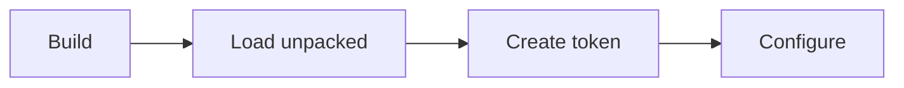
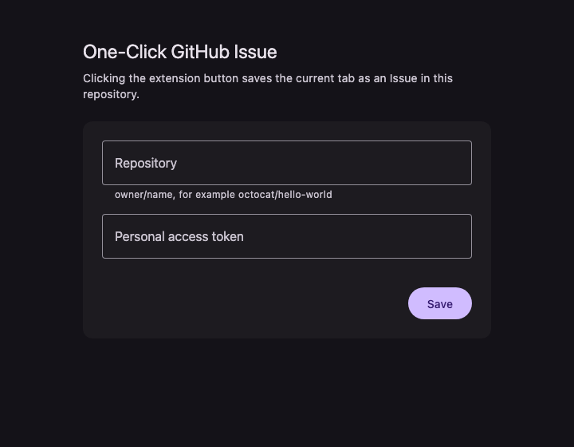

# One-Click GitHub Issue

Chrome extension that saves the current tab as a GitHub Issue with one click.

| Issue part | Content |
|---|---|
| Title | Page title, or the page URL when the title is empty |
| Body | Page URL |

## Setup



### 1. Build

Requires Node.js 24 and pnpm.

```sh
pnpm install
pnpm build
```

### 2. Load unpacked

- Open `chrome://extensions`
- Turn on Developer mode
- Click Load unpacked
  - Select the `dist` directory

### 3. Create a token

Open GitHub Settings, Developer settings, Fine-grained tokens, Generate new token.

| Field | Value |
|---|---|
| Expiration | Any date |
| Repository access | Only select repositories, then the target repository |
| Issues permission | Read and write |
| Other permissions | Not set |

### 4. Configure

- Click the extension button
  - The settings page opens
- Enter the target repository as `owner/name`
- Paste the token
- Click Save



## Usage

Click the extension button on any page.

| Badge | Meaning |
|---|---|
| ✓ | Issue created |
| ✗ | Failed, for example a page without a URL |
| None | No result yet in this tab |

- Settings page opens instead
  - Settings are incomplete
  - Token expired or revoked
- Each click creates a new Issue

## Token storage

- Not stored on disk
- Lost on browser restart or extension update
  - Paste it again in the settings page
  - Keep it in a password manager

## Visibility

Saved titles and URLs follow the target repository's visibility.

| Repository | Who can read |
|---|---|
| Public | Anyone |
| Private | Users with access |

## Docs

- [Design doc](docs/design/one-click-github-issue.md)
- [Token ADR](docs/adr/authenticate-with-fine-grained-pat.md)
- [Session storage ADR](docs/adr/keep-the-token-in-session-storage.md)
