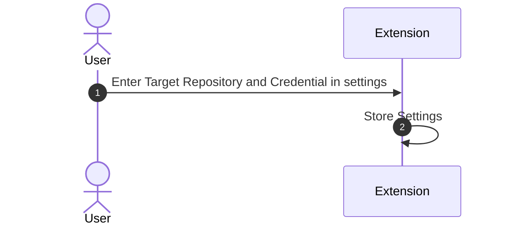
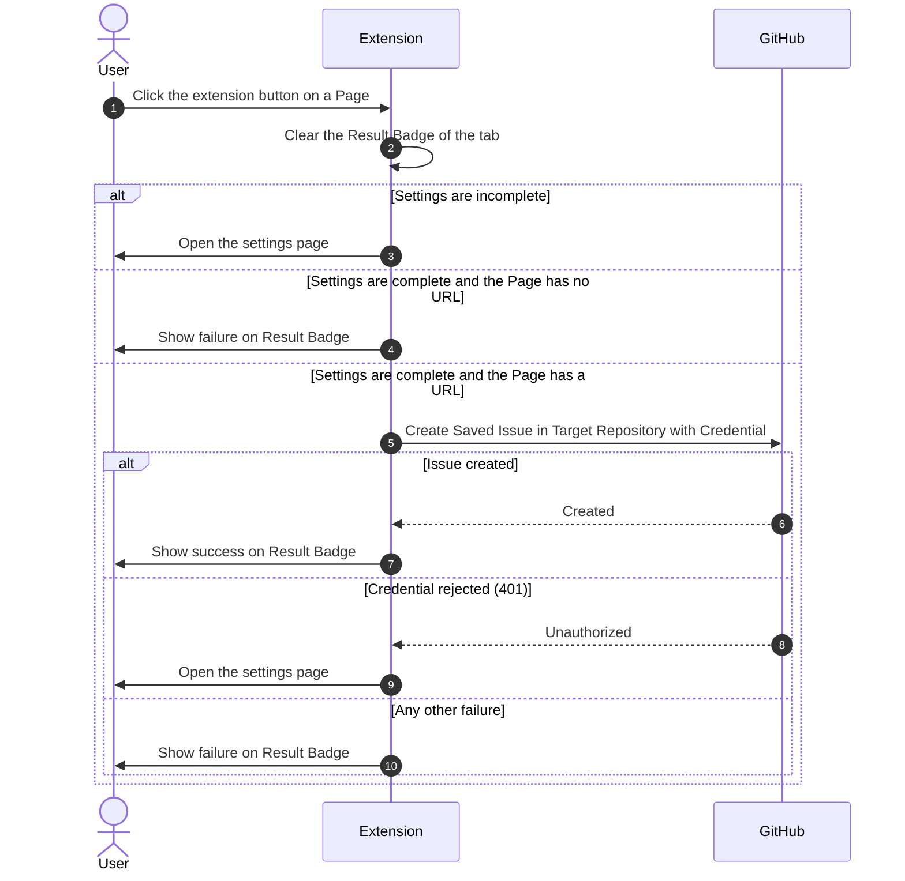

# One-Click GitHub Issue

## Overview

A Chrome extension that saves the page in the active tab as a GitHub Issue in one repository the user chooses, with a single click on the extension button. It is inspired by One-Click TickTick, which does the same for TickTick tasks.

It is responsible for turning the active tab into an Issue and telling the user whether that succeeded. It does not read page content and does not manage Issues after creating them.

## Domain Model

- **Page**: the tab active when the user clicks the extension button. It has a title, and a URL unless Chrome withholds it, as on restricted pages such as `chrome://` pages and the Chrome Web Store.
- **Target Repository**: the single repository, identified by owner and name, that receives every Issue.
- **Credential**: the token that lets the extension create Issues in the Target Repository on behalf of the account that owns it. The ADR decides how the user obtains it.
- **Settings**: the Target Repository and the Credential. Settings are complete when both are present.
- **Saved Issue**: the Issue created from a Page. Its title is the Page title, or the Page URL when the title is empty, cut to GitHub's 256-character limit with a trailing `…` when longer. Its body is the Page URL.
- **Result Badge**: the mark on the extension button, per tab, that shows the outcome of the last click in that tab: success, failure, or none.

## Scenarios

### Configure

The user enters the Target Repository and the Credential once, so that later clicks need no input.

### Save the current page

The user clicks the extension button to keep the Page as an Issue without leaving it.

## Invariants

- The extension sends only the Page title and the Page URL, and sends them only to the Target Repository through the GitHub API.
- The Credential is sent only to the GitHub API and is stored only on this device; it is never written to browser sync storage.
- The Page title is written only to the Issue title, never to the body, because GitHub turns `@name` in a body into a mention that notifies that person.
- The extension does not check whether the Target Repository is public or private. Whether saved titles and URLs become public is the user's responsibility; in a public repository, a body URL that points to another GitHub Issue or pull request leaves a visible reference on it.
- Each click creates a new Issue. The extension does not look for an existing Issue with the same URL, so clicking twice on a Page creates two Issues.

## References

- [Authenticate with a fine-grained PAT until store publication](../adr/authenticate-with-fine-grained-pat.md)
- [One-Click TickTick](https://github.com/chrschorn/one-click-ticktick)
